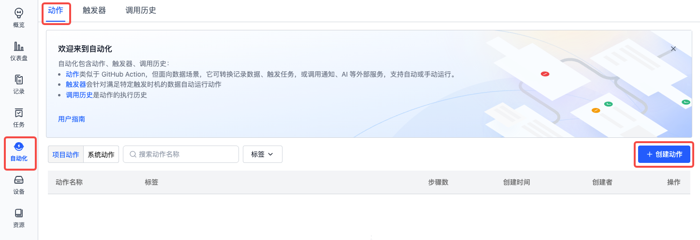
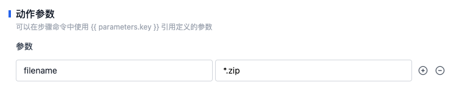

# 复制动作

以创建一个「解压文件」的动作为例，介绍如何通过从已有动作复制步骤创建动作。

1. 进入项目，在「自动化-动作」页面，点击【创建动作】按钮。

   

2. 在创建动作页面，填写动作名称、从已有动作复制步骤。

- 动作名称：解压文件
- 添加步骤：从已有系统动作「解压文件」复制「main」步骤

  

- 添加参数：添加参数 `filename`，值为 `*.zip`，供命令 `{{parameters.filename}}` 引用此参数，表示对指定目录下名称符合 `*.zip` 的文件进行解压

  

3. 点击【创建动作】按钮，完成动作创建。调用此动作可对记录中名称符合 `*.zip` 的文件进行解压，并将结果输出到「调用详情」的「输出」页面。
