# 关于数据可视化

数据可视化界面通过可配置的「面板」和「布局」，将设备数据以直观的可视化方式呈现，助力用户高效分析与诊断各类问题。

## 如何进行进入可视化界面

在记录中，点击【播放记录】进入可视化界面

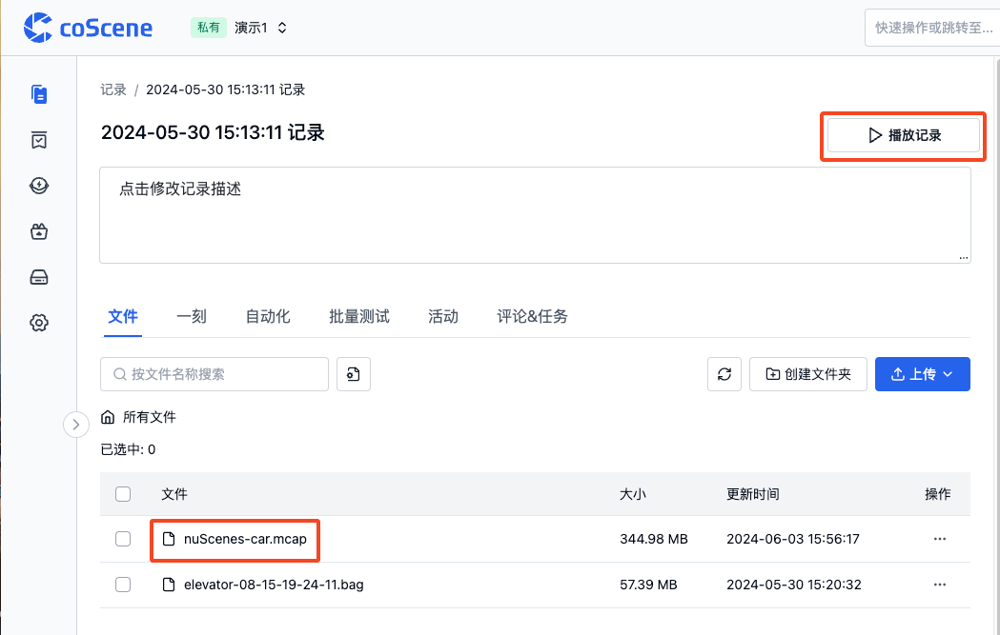

## 可视化界面的基本元素

可视化界面的基本元素包括「顶部工具栏」、「面板」、「侧边栏」和「时间轴」。

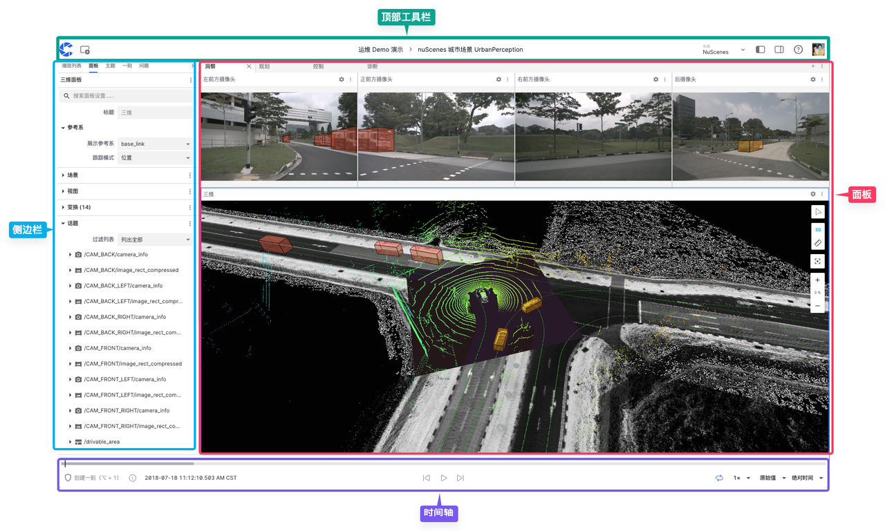

### 顶部工具栏

「顶部工具栏」是用户在可视化界面中进行导航和访问部分功能的区域

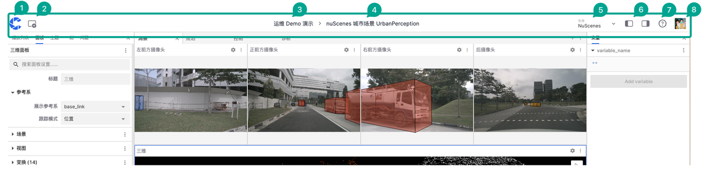

以下是该区域的功能介绍：

1. 返回首页
2. 添加面板
3. 所属项目名称
4. 所属记录名称
5. 布局菜单栏
6. 显示/隐藏左右侧边栏
7. 帮助文档
8. 用户菜单栏

### 面板

「面板」是模块化的可视化界面，允许用户添加、编辑和拖放不同模块。它可以配置和排列成个性化的「布局」与组织和项目共享。

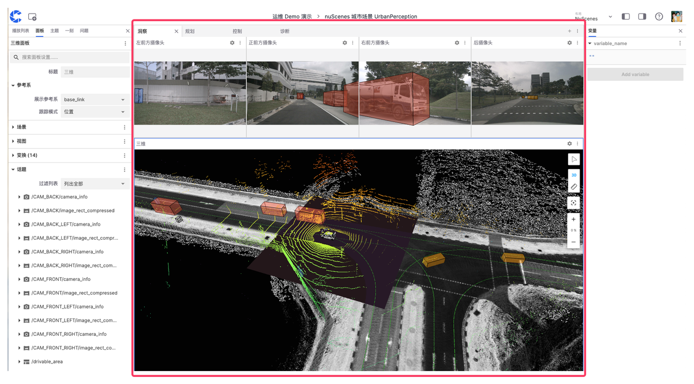

### 侧边栏

「侧边栏」是可视化界面中用于配置和管理不同设置和信息的界面，分为「左侧边栏」和「右侧边栏」。

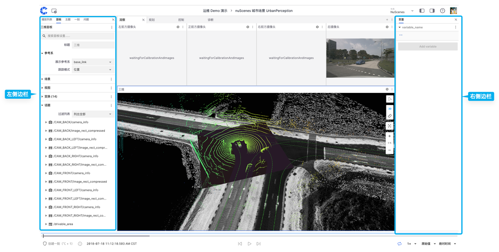

#### 左侧边栏

「左侧边栏」可以显示【播放列表】、【面板】、【主题】、【一刻】和【问题】的信息。

##### 播放列表

「播放列表」是用于管理数据文件的工具，支持按序或按需播放不同的文件。「添加文件」还支持从组织内添加不同项目的记录文件。

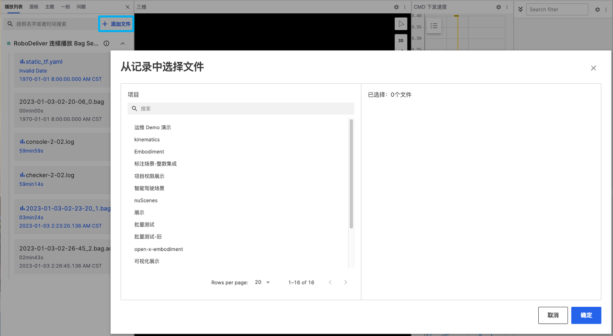

##### 面板

「面板」中可以查看和更改当前面板的属性，可点击不同类型的面板进行切换。

##### 主题

「主题」是指数据流的类别或频道，每个主题代表一种特定类型的数据源或传感器数据，用户可以在搜索栏中筛选。

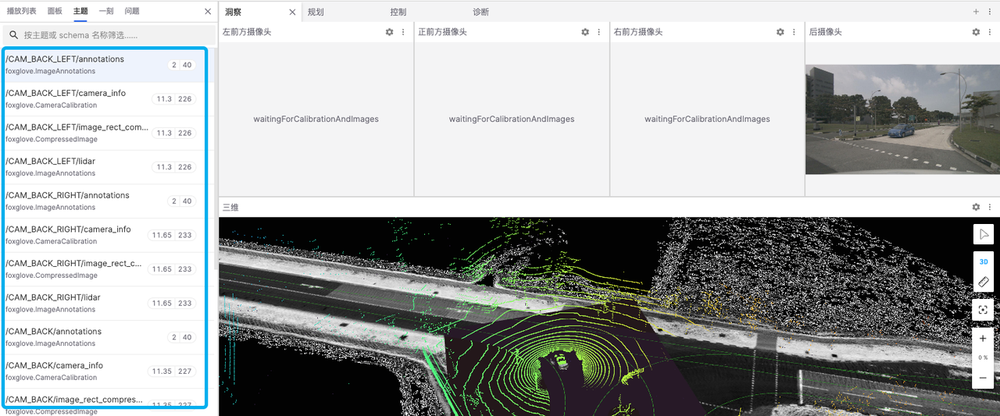

##### 一刻

「一刻」列表中可以显示、编辑、复制和删除创建的一刻

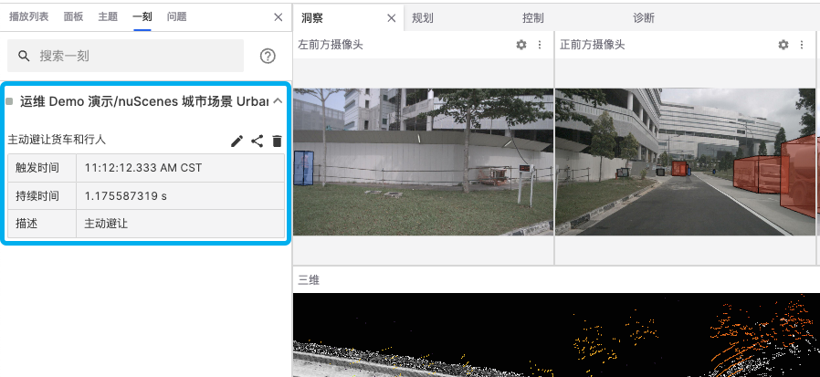

##### 问题

「问题」列表可以显示可视化界面出现故障时的具体错误类型。例如，图中出现了 "network error" 这个问题从而导致面板加载失败。

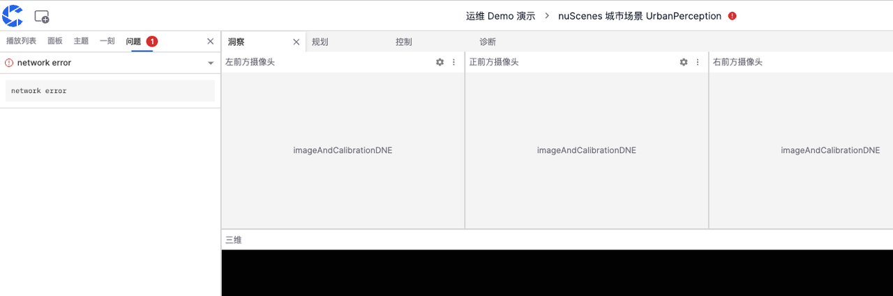

#### 右侧边栏

可视化界面中的「右侧边栏」可编辑变量信息

### 时间轴 {#timeline}

时间轴用于播放、暂停、跳转和查看一刻。可拖动上边缘调整高度，拖动轨道列表右侧分隔线调整列表宽度。

| 控件                        | 用途                                                         |
| --------------------------- | ------------------------------------------------------------ |
| 后退 / 前进                 | 暂停时按指定步长跳转；步长在“更多时间轴工具”中设置。         |
| 播放 / 暂停                 | 开始或暂停当前回放。                                         |
| 循环播放                    | 重复播放当前回放范围；从一刻进入回放时可用于重复查看该片段。 |
| 当前播放时间 / 时间显示格式 | 查看和调整播放时间，切换时间格式。                           |
| 创建一刻                    | 在时间轴上选择起止点，创建关键片段。                         |
| 一刻字幕 / 联动调整         | 控制一刻名称的字幕显示，以及时间范围编辑时的联动调整。       |
| 缩放 / 缩放以适应           | 调整时间轴可见范围；这与播放速度是不同的设置。               |
| 更多时间轴工具              | 查看快捷键、修改步长，并进入项目的一刻分组与分轨设置。       |

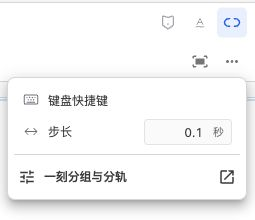

#### 倍速播放 {#playback-speed}

点击倍速按钮，拖动滑块选择 **0.01× 至 10×** 的预设速度。重置按钮恢复 **1×**；滑块获得焦点后也可用方向键逐档调整。倍速只改变回放速度，不修改原始数据时间戳。

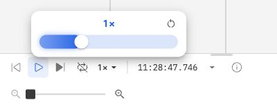

#### 一刻轨道 {#moment-tracks}

一刻会按照项目配置显示在分组和自定义字段轨道中。轨道和字段值可使用不同颜色，不应再将所有一刻理解为同一种蓝色矩形。可展开或折叠分组，通过眼睛图标切换支持显隐的轨道；隐藏不会删除一刻。

具体分组、字段轨道及创建操作见[一刻](./5-create-moment-viz.md#grouping-and-tracks)。

---
