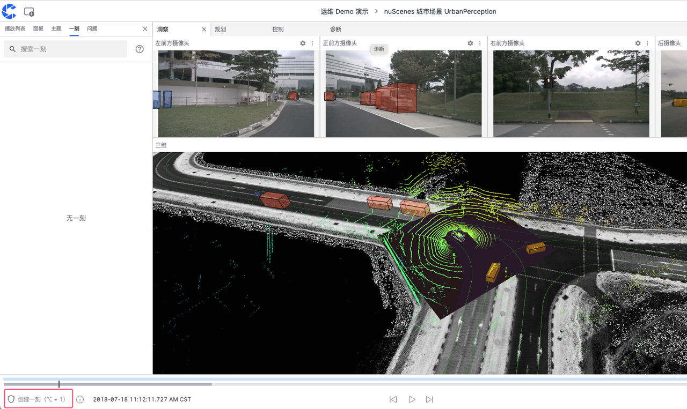
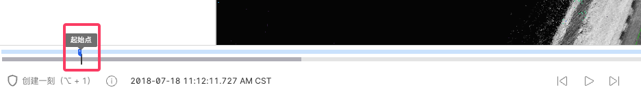
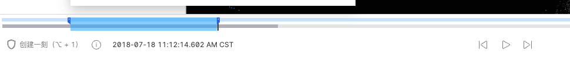
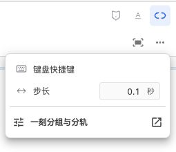
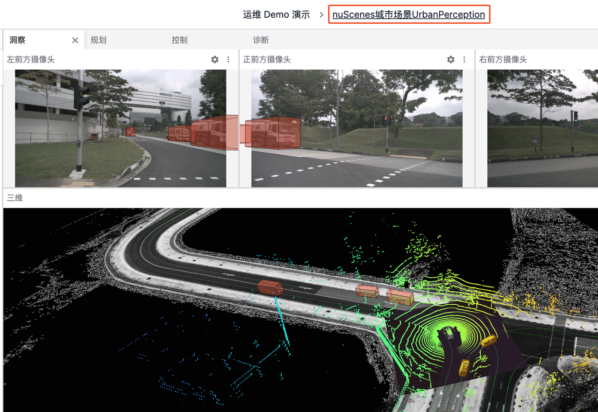
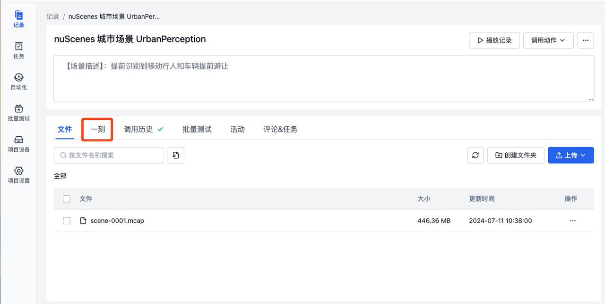
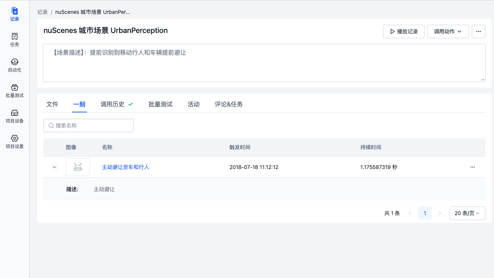

# 一刻

「一刻」是记录中的关键片段，它可以是可视化界面中故障或感兴趣的画面

## 创建一刻

1. 点击记录中的【播放记录】按钮进入可视化界面

2. 点击左下角的【创建一刻】按钮，选择起止点
   如图，可使用快捷键或点击【创建一刻】按钮在需要的时间点确定起点

在需要的时间点再次点击确定终点，图示蓝色范围就是「一刻」的起止时间

3. 可通过点击拖动更改「一刻」的范围
4. 输入名称，描述等字段信息完成创建

## 管理一刻

在左侧边栏中的【一刻】中实现对「一刻」的编辑，复制和删除

### 编辑一刻

点击图示编辑按钮修改「一刻」的字段信息

### 复制一刻

点击图示复制按钮来将当前「一刻」的链接复制到剪切板

### 删除一刻

点击图示删除按钮来删除这条「一刻」

## 分组与自定义字段轨道 {#grouping-and-tracks}

在时间轴的“更多时间轴工具”中点击“一刻分组与分轨”，进入当前项目的一刻自定义字段设置。

- **分组**：按配置顺序使用单选枚举字段构建层级，最多五层。未填写字段的一刻会显示在“未填写”组中。分组名称与字段值来自项目配置。
- **自定义字段轨道**：将配置的字段显示为附加轨道，帮助对照同一批一刻的字段值。一个一刻出现在多个字段轨道中不表示创建了重复记录。
- **颜色**：分组轨道和字段值使用颜色区分。颜色不是一刻状态的统一判定规则，应结合轨道标签和字段值阅读。
- **折叠与显隐**：使用箭头展开或折叠分组。没有子分组的轨道和字段轨道可通过眼睛图标隐藏或恢复显示；隐藏不删除数据。

分组与分轨规则属于项目配置，会影响该项目的一刻展示。显示、隐藏、折叠等时间轴操作用于调整当前视图，不会修改一刻的字段值。

## 创建与回放提示 {#creation-and-playback}

创建一刻时，可视化会记住本次会话中上一条一刻的自定义字段，减少重复填写。提交前仍应确认这些值适用于新片段。

通过一刻定位片段后，可开启循环播放反复检查，并用[倍速滑块](./1-about-viz.md#playback-speed)调整速度。修改一刻范围时，先确认时间轴中的联动调整状态，避免相邻范围的变化与预期不符。

## 查看一刻

1. 点击可视化页面顶部工具栏中的记录名称，前往记录详情页

2. 点击图示的【一刻】按钮

3. 进入一刻详情页，查看「一刻」的信息

---
