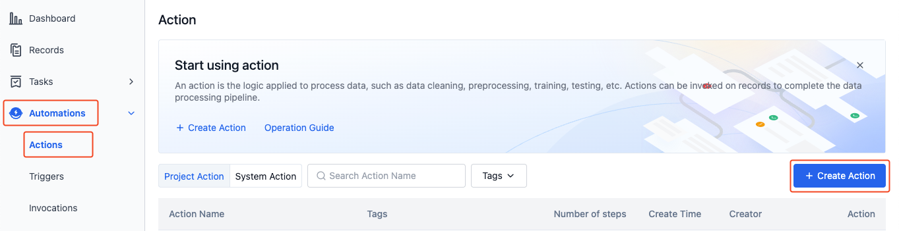
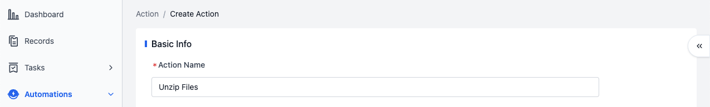
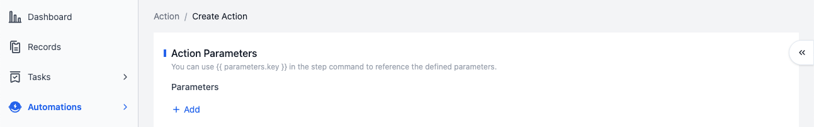
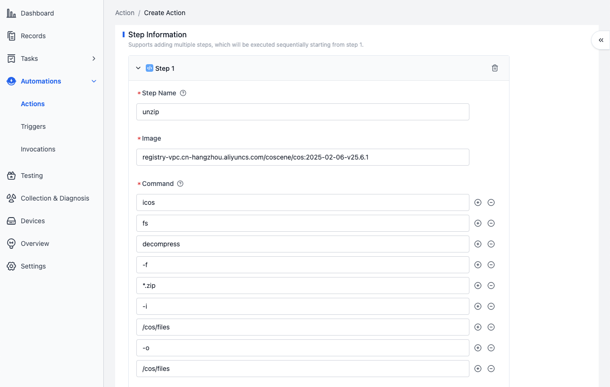
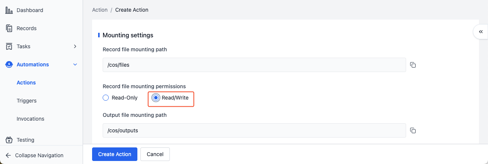
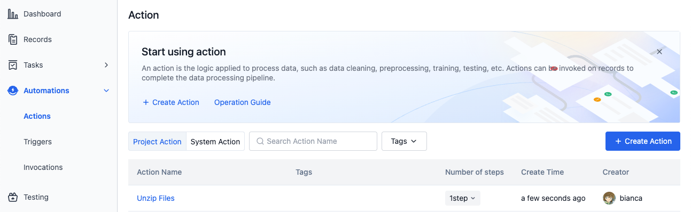

# Create an Image Code Action

Take creating an action for "Unzipping Files" as an example to illustrate how to create an action by adding a "Image Code Execution" step.

1. Enter the project, go to the "Automation - Actions" page, and click the "Create Action" button.

   

2. On the action creation page, fill in information such as the action name and steps.

- Action name: Unzip Files

  

- Add a "Image Code Execution" step:

  

- Step name: unzip
- Image: registry-vpc.cn-hangzhou.aliyuncs.com/coscene/cos:2025-02-06-v25.6.1
  - This image is provided by Kehang Space-Time, with the `icos` tool built - in. It only supports use within the platform. Learn more about [images](../../image/1-about-docker-image.md).
- Command: icos fs decompress f \*.zip -i /cos/files -o /cos/files
  - Call the `icos` tool to decompress files whose names match `*.zip` in the `/cos/files` directory (record), and output the results to the original record.
  - You need to fill in one parameter per line. For example, fill in `icos` on the first line, `fs` on the second line, and so on.

  

- Record file mount permission: Read/Write
  - Allow this action to read from and write to the original record during execution.

  

3. Click the "Create Action" button to complete the action creation. Calling this action can decompress files whose names match `*.zip` in the record.

   
