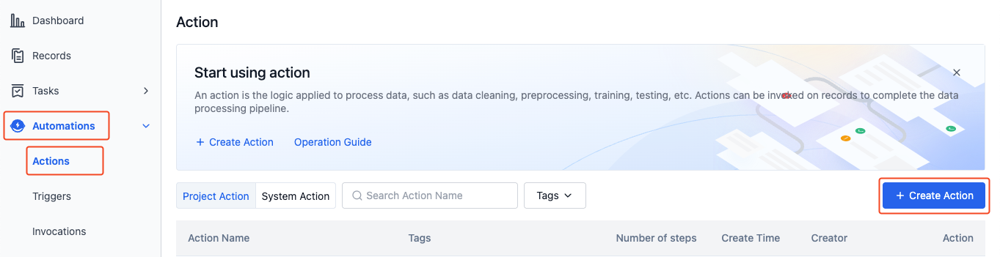
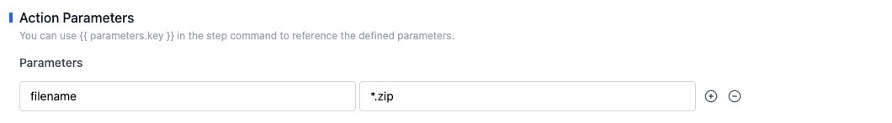

# Copy an Action

Take creating an action for "Unzipping Files" as an example to illustrate how to create an action by copying steps from an existing action.

1. Enter the project, go to the "Automation - Actions" page, and click the "Create Action" button.

   

2. On the action creation page, fill in the action name and copy steps from an existing action.

- Action name: Unzip Files
- Add a step: Copy the "main" step from the existing system action "Unzip Files".

  

- Add a parameter: Add the parameter `filename` with a value of `*.zip` for the command `{{parameters.filename}}` to reference this parameter, indicating that files whose names match `*.zip` in the specified directory will be decompressed.

  

3. Click the "Create Action" button to complete the action creation. Calling this action can decompress files whose names match `*.zip` in the record and output the results to the "Output" page of the "Invocation Details".
