# About Data Visualization

The data visualization interface presents device data in an intuitive visual manner through configurable "Panels" and "Layouts", empowering users to efficiently analyze and diagnose various issues.

## How to Enter the Visualization Interface

In a Record, click **Play** to enter the visualization interface.

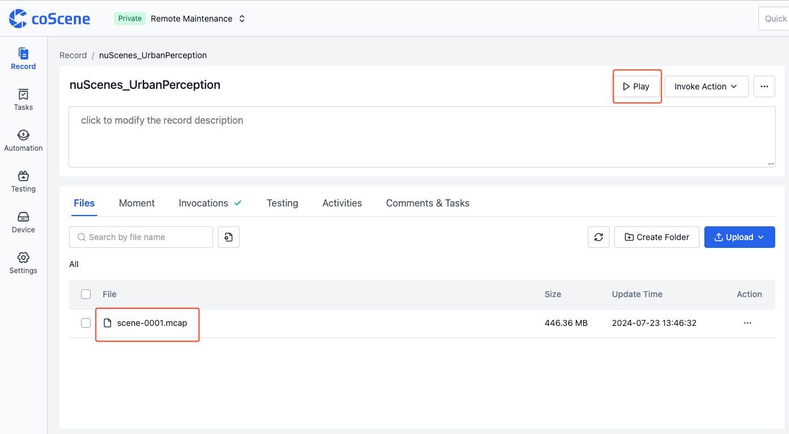

## Basic Elements of the Visualization Interface

The basic elements of the visualization interface include the **Top Toolbar**, **Panel**, **Sidebar**, and **Timeline**.

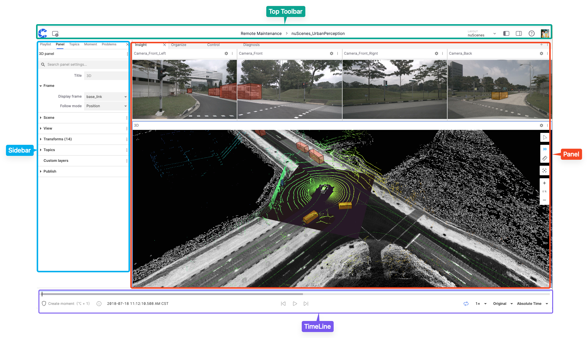

### Top Toolbar

The **Top Toolbar** is the area for navigation and access to various functions within the visualization interface.

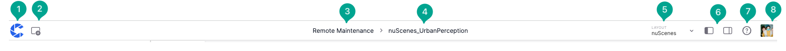

The functions in this area include:

1. **Home** Button
2. **Add Panel** Button
3. Project Name
4. Record Name
5. **Layout** Menu
6. Collapse Left/Right Sidebar Buttons
7. **Help Documentation**
8. **User Menu**

### Panel

The "Panel" is a modular visualization interface that allows users to add, edit, and drag-and-drop different modules. It can be configured and arranged into personalized "layouts" to be shared with the organization and projects.

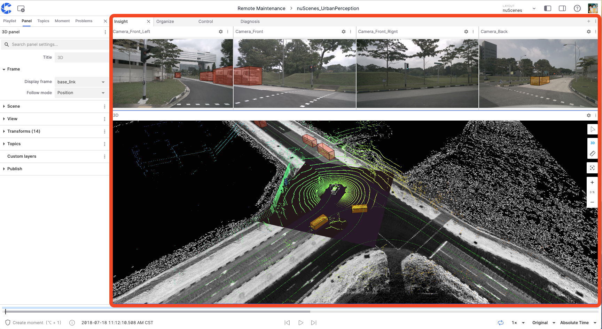

### Sidebar

The "Sidebar" is the interface for configuring and managing different settings and information within the visualization interface, divided into "Left Sidebar" and "Right Sidebar."

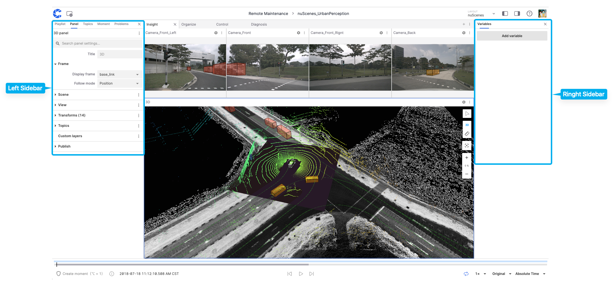

#### Left Sidebar

The "Left Sidebar" can display information such as **Playlists**, **Panels**, **Themes**, **Moments**, and **Issues**.

**Playlists**

The "Playlists" tool manages data files, supporting the sequential or on-demand playback of different files. The "Add File" option also supports adding Record files from different projects within the organization.

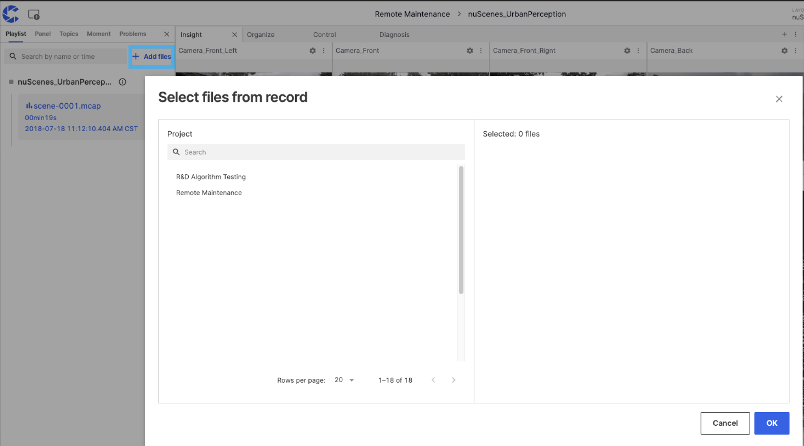

**Panels**

The **Panels** section allows viewing and changing the properties of the current panel. Users can switch between different types of "panels."

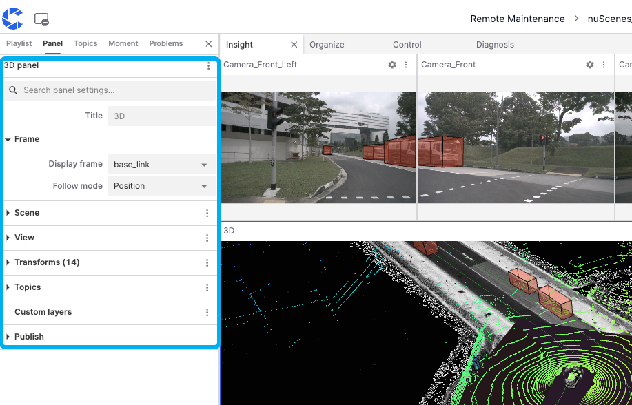

**Themes**

**Themes** refer to the categories or channels of data streams. Each theme represents a specific type of data source or sensor data, which users can filter in the search bar.

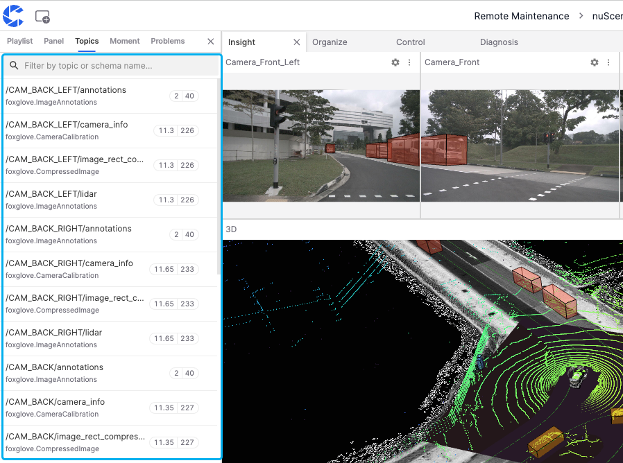

**Moments**

The **Moments** list allows users to display, edit, copy, and delete created moments.

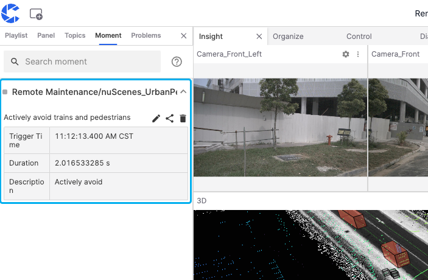

**Issues**

The **Issues** list shows specific error types when a fault occurs in the visualization interface. For example, "network error" appears in the image, causing the panel to fail to load.

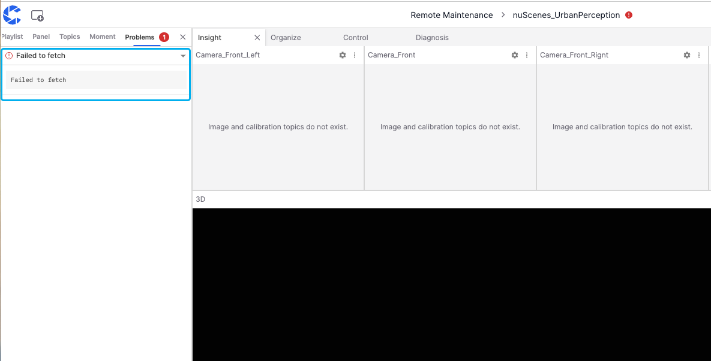

#### Right Sidebar

The "Right Sidebar" in the visualization interface allows editing variable information.

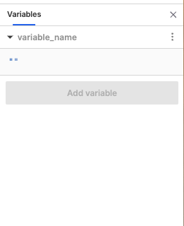

### Timeline {#timeline}

Use the timeline to play, pause, seek, and inspect Moments. Drag its upper edge to adjust its height, or the divider beside the track list to adjust the list width.

| Control                                     | Purpose                                                                                                      |
| ------------------------------------------- | ------------------------------------------------------------------------------------------------------------ |
| Seek backward / forward                     | Seek by the configured step interval while paused. Set the interval in More timeline tools.                  |
| Play / Pause                                | Start or pause playback.                                                                                     |
| Loop playback                               | Repeat the current playback range; when replaying a Moment, use it to review that segment repeatedly.        |
| Current playback time / Time display format | View and adjust playback time, and change its display format.                                                |
| Create Moment                               | Select start and end points on the timeline to create a segment.                                             |
| Moment subtitles / Linked event adjustment  | Control subtitles for Moment names and linked adjustment when editing time ranges.                           |
| Zoom / Zoom to fit                          | Change the visible timeline range. This is separate from playback speed.                                     |
| More timeline tools                         | View keyboard shortcuts, change the step interval, and open project settings for Moment grouping and tracks. |

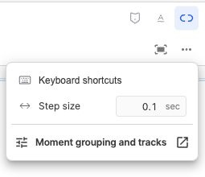

#### Playback speed {#playback-speed}

Click the speed button and drag the slider to select a preset from **0.01× to 10×**. The reset button restores **1×**. With the slider focused, use the arrow keys to move between presets. Speed changes affect playback without changing the original data timestamps.

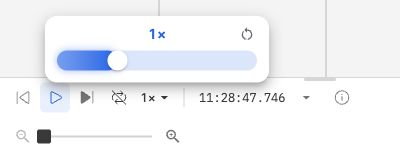

#### Moment tracks {#moment-tracks}

Moments appear in groups and custom-field tracks according to project settings. Tracks and field values can use different colors; Moments are no longer all represented by one blue rectangle. Expand or collapse groups and use the eye icon on tracks that support visibility controls. Hiding a track does not delete its Moments.

See [Moments](./5-create-moment-viz.md#grouping-and-tracks) for grouping, field tracks, and creation steps.

---
