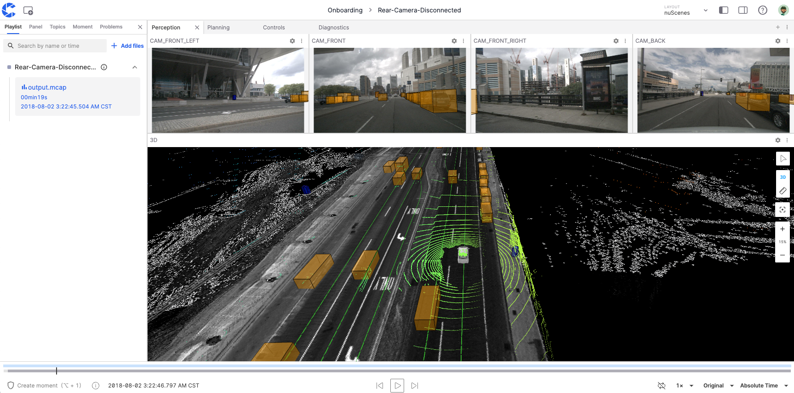
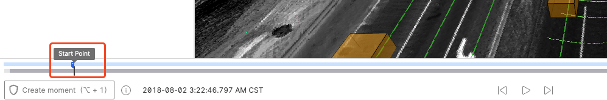
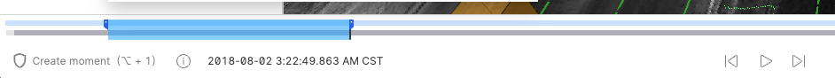
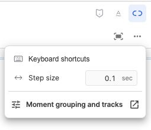
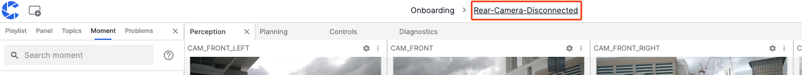
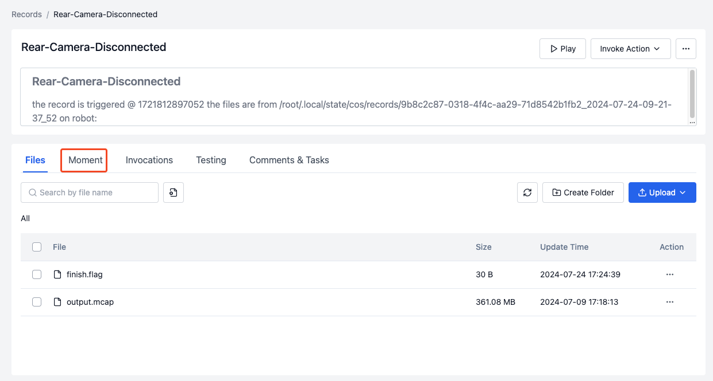
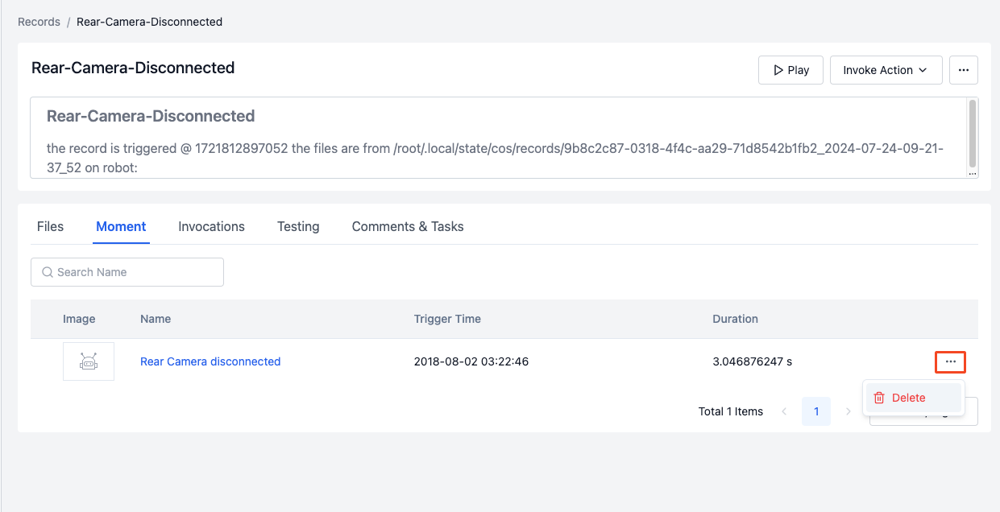

# Moments

"Moments" are key frames in records, capturing either faults or interesting scenes in the visualization interface.

## Creating a Moment

1. Click the **Play Record** button in the record to enter the visualization interface.

   

2. Click the **Create Moment** button in the lower left corner and select the start and end points. As shown, you can use shortcut keys or click the **Create Moment** button to set the start point at the desired time.

   

   Click again at the desired time to set the end point. The blue range in the illustration shows the start and end time of the moment.

   

3. You can change the range of the moment by clicking and dragging.

4. Enter the name, description, and other field information to complete the creation.

   

## Managing Moments

Manage moments in the **Moments** section of the left sidebar, where you can edit, copy, and delete moments.

### Editing a Moment

Click the edit button shown in the illustration to modify the field information of the moment.

### Copying a Moment Link

Click the copy button shown in the illustration to copy the link of the current moment to the clipboard.

### Deleting a Moment

Click the delete button shown in the illustration to delete this moment.

## Grouping and custom-field tracks {#grouping-and-tracks}

Open More timeline tools and select Moment grouping and tracks to visit the current project’s Moment custom-field settings.

- **Grouping:** Single-select enum fields form a hierarchy in the configured order, with up to five levels. Moments without a field value appear in the Not filled group. Group names and field values come from project configuration.
- **Custom-field tracks:** Configured fields appear as additional tracks so you can compare values for the same Moments. A Moment appearing on multiple field tracks does not create duplicate records.
- **Colors:** Group tracks and field values use colors for distinction. Colors are not a universal status rule; read them together with track labels and field values.
- **Collapse and visibility:** Use arrows to expand or collapse groups. Tracks without child groups, and custom-field tracks, offer eye icons to hide or restore visibility. Hiding does not delete data.

Grouping and track rules belong to the project and affect its Moment display. Timeline visibility and collapse controls adjust the current view without changing Moment field values.

## Creation and playback tips {#creation-and-playback}

When creating a Moment, the visualization remembers the previous Moment’s custom fields within the current session to reduce repeated entry. Review those values before submitting a new segment.

After navigating to a Moment, enable loop playback to review the segment repeatedly and adjust speed using the [playback speed slider](./1-about-viz.md#playback-speed). Before editing a Moment range, check the linked adjustment setting to avoid unexpected changes to neighboring ranges.

## Viewing Moments

1. Click the record name in the top toolbar of the visualization page to go to the record details page.

   

2. Click the **Moments** button shown in the illustration.

   

3. Enter the moment details page to view the information of the created moments. They can also be deleted here.

   

---
